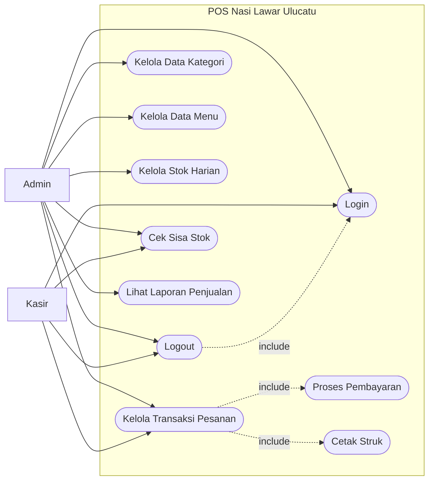
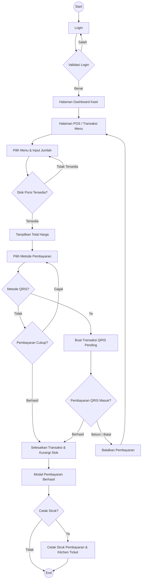
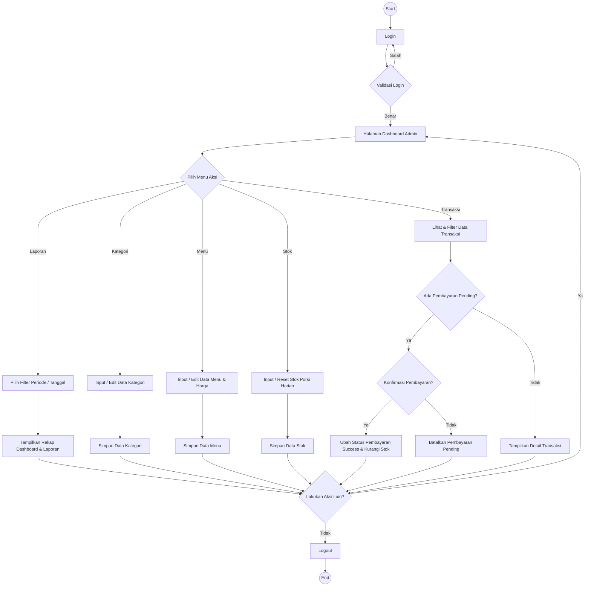
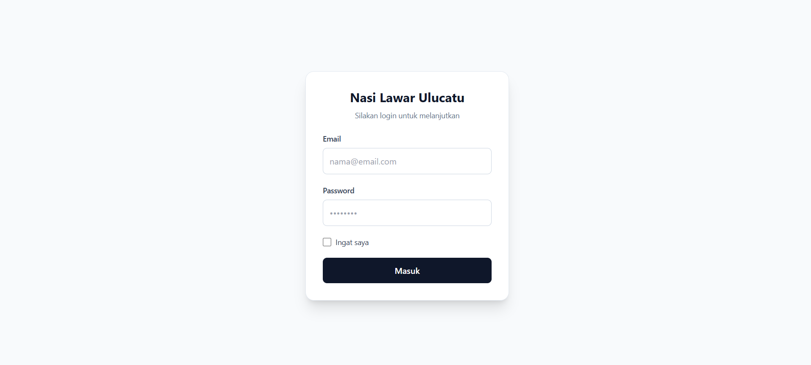

# TUGAS KELOMPOK

## SOFTWARE REQUIREMENTS SPECIFICATION SISTEM POS RUMAH MAKAN NASI LAWAR ULUCATU

**"Mata Kuliah Rekayasa Perangkat Lunak"**

---

**Oleh:**

| Nama | NIM |
|------|-----|
| Kadek Wahyu Santika Putra | 42430012 |
| I Nyoman Theo Ardiles Rada | 42430018 |

---

**PROGRAM STUDI TEKNOLOGI INFORMASI**
**FAKULTAS TEKNIK DAN INFORMATIKA**
**UNIVERSITAS PENDIDIKAN NASIONAL**
**2026**

---

## 1. Pendahuluan

### 1.1 Latar Belakang

Rumah Makan Nasi Lawar Ulucatu merupakan usaha kuliner lokal yang memiliki perputaran pelanggan yang tinggi, terutama pada jam sibuk (*peak hour*). Saat ini, sistem operasional dan pencatatan pesanan masih dilakukan secara manual dan sangat mengandalkan ingatan pegawai. Hal ini sering menimbulkan masalah seperti *human error* dalam perhitungan total pesanan, pelanggan komplain karena pesanan lupa dibuatkan, hingga risiko kehabisan bahan baku (daging/darah) secara mendadak karena ketiadaan sistem pemantauan stok. Dokumen SRS ini disusun untuk mendefinisikan kebutuhan sistem *Point of Sales* (POS) secara terstruktur agar pengembangan aplikasi kasir digital dapat berjalan selaras dengan kebutuhan pemilik usaha dalam mengatasi kendala operasional tersebut.

### 1.2 Tujuan

1. **Meningkatkan Efisiensi Pelayanan**: Mengganti sistem pencatatan hafalan/manual menjadi sistem digital dengan alur *Pay-First*, guna meminimalkan *human error* dan mempercepat antrean saat jam sibuk.
2. **Mempermudah Kontrol Bisnis**: Mengotomatisasi pemotongan stok porsi secara *real-time* untuk mencegah kehabisan bahan baku mendadak, serta merekap pendapatan harian secara otomatis bagi pemilik.
3. **Menjadi Acuan Pengembangan**: Menyediakan spesifikasi teknis yang jelas dan terstruktur bagi pengembang perangkat lunak agar aplikasi dibangun tepat sasaran sesuai masalah di lapangan.

### 1.3 Lingkup Proyek

- Pengembangan sistem aplikasi Kasir (*Point of Sales*) yang difokuskan pada manajemen pesanan dengan alur pembayaran di muka (*Pay First*).
- Fitur utama meliputi: pencatatan transaksi kasir, manajemen menu dan harga, pemotongan stok porsi secara otomatis, serta pembuatan laporan penjualan harian.
- Proyek ini mencakup pembuatan aplikasi berbasis antarmuka mobile/tablet (Android) yang dirancang agar ringan dan mampu beroperasi optimal pada kondisi jaringan internet yang tidak stabil (menggunakan koneksi data seluler).

### 1.4 Definisi Istilah

- **Kasir**: Karyawan/Pegawai yang bertugas di area depan untuk menerima pesanan, menginput data ke aplikasi, dan memproses pembayaran pelanggan.
- **Owner (Admin)**: Pemilik usaha yang memiliki hak akses penuh ke sistem *back-end* untuk mengatur master data (menu, harga, stok harian) dan melihat laporan keuangan.
- **POS (Point of Sales)**: Perangkat lunak kasir yang digunakan untuk memfasilitasi transaksi jual-beli di rumah makan.
- **Pay First**: Alur proses bisnis di mana pelanggan diwajibkan melakukan pembayaran terlebih dahulu sebelum pesanan diproses dan disajikan oleh dapur.
- **Sold Out**: Status sistem yang menandakan bahwa kuota stok porsi harian untuk suatu menu telah habis dan tidak dapat dipesan lagi.

---

## 2. Gambaran Umum Sistem

### 2.1 Konteks Bisnis

Sistem POS (*Point of Sales*) ini dirancang khusus untuk mendigitalisasi operasional Rumah Makan Nasi Lawar Ulucatu yang baru beroperasi sejak Februari 2026. Sistem ini akan memfasilitasi perubahan alur pelayanan dari pembayaran di akhir menjadi pembayaran di muka (*Pay-First*). Transformasi ini bertujuan untuk mempercepat antrean, menghilangkan kerugian akibat pesanan yang terlupa atau salah hitung saat jam sibuk, serta memberikan kepastian pencatatan omzet harian secara presisi bagi pemilik usaha.

### 2.2 Profil Pengguna

Sistem ini memisahkan hak akses menjadi dua peran utama sesuai dengan struktur operasional rumah makan:

- **Kasir (Pegawai)**: Bertindak sebagai operator utama di lapangan yang sudah terbiasa dan mahir mengoperasikan gadget. Kasir membutuhkan antarmuka yang cepat untuk menginput pesanan, memproses transaksi (Tunai, QRIS, Transfer), dan memeriksa ketersediaan sisa porsi secara langsung agar dapat segera menginformasikan status *sold out* kepada pelanggan.
- **Admin (Owner)**: Bertindak sebagai pengelola bisnis. Membutuhkan *dashboard* khusus untuk memantau laporan pendapatan harian, mengatur jumlah stok porsi yang tersedia di pagi hari, menyesuaikan harga menu jika terjadi fluktuasi harga bahan pokok, dan melihat data menu terlaris tanpa harus melakukan rekapitulasi manual di malam hari.

### 2.3 Batasan Sistem

- **Platform Target**: Aplikasi difokuskan untuk beroperasi secara optimal pada perangkat Mobile atau Tablet yang sudah tersedia di lokasi usaha.
- **Kondisi Jaringan**: Mengingat infrastruktur WiFi di lokasi (Pecatu) tidak stabil, aplikasi harus dirancang ringan dan tangguh untuk beroperasi menggunakan koneksi data seluler.
- **Logika Inventori**: Manajemen ketersediaan bahan dikelola secara sederhana berdasarkan jumlah porsi (misalnya 100-200 porsi per hari), bukan penghitungan gramasi detail dari bahan mentah.

---

## 3. Kebutuhan Fungsional

### 3.1 Autentikasi dan Hak Akses

1. **FR-1**: Sistem harus menyediakan halaman *Login* menggunakan *username* dan *password*.
2. **FR-2**: Sistem harus dapat membedakan hak akses masuk antara peran Admin (Owner) dan peran Kasir (Pegawai).
3. **FR-3**: Sistem harus memiliki fitur *Logout* untuk mengakhiri sesi pengguna yang sedang aktif.

### 3.2 Manajemen Master Data (Khusus Admin)

1. **FR-4**: Sistem memungkinkan Admin untuk menambah, mengubah harga, dan menghapus data menu makanan, minuman, maupun paket kombo.
2. **FR-5**: Sistem harus menyediakan formulir bagi Admin untuk menginput "Stok Porsi Harian" (misalnya: 100 porsi) pada awal hari operasional.

### 3.3 Proses Transaksi Point of Sales (Khusus Kasir)

1. **FR-6**: Sistem harus menyediakan antarmuka bagi Kasir untuk menginput pesanan baru, memilih jenis layanan (*Dine-in* atau *Take-away*), dan memasukkan nomor meja/antrean.
2. **FR-7**: Sistem harus dapat menghitung subtotal dan total harga pesanan secara otomatis (mengurangi risiko *human error*).
3. **FR-8**: Sistem wajib memvalidasi ketersediaan stok porsi secara otomatis. Jika stok menu yang dipilih habis (0), sistem akan menampilkan peringatan "Stok Habis" dan menolak input menu tersebut.
4. **FR-9**: Sistem harus mendukung penyelesaian transaksi dengan berbagai metode pembayaran (Tunai, QRIS, dan Transfer Bank).
5. **FR-10**: Setelah pembayaran berhasil divalidasi, sistem wajib mengurangi jumlah stok porsi harian secara otomatis (*real-time*).
6. **FR-11**: Sistem harus dapat mencetak struk transaksi (satu salinan untuk pelanggan sebagai bukti bayar, dan satu salinan untuk dapur sebagai tiket pesanan).

### 3.4 Dasbor Laporan dan Analitik (Khusus Admin)

1. **FR-12**: Sistem harus menyediakan dasbor rekapitulasi total pendapatan (omzet) harian.
2. **FR-13**: Sistem harus dapat menampilkan laporan sisa porsi harian untuk memantau pergerakan stok secara langsung.
3. **FR-14**: Sistem harus menyediakan laporan daftar menu terlaris (Pareto) berdasarkan data transaksi yang sudah berhasil diselesaikan.

---

## 4. Kebutuhan Non-Fungsional

### 4.1 Performa (Performance)

1. **NFR-1**: Sistem harus memiliki waktu respons yang sangat cepat (kurang dari 2 detik) saat Kasir memasukkan pesanan dan menekan tombol "Proses Pembayaran", guna mencegah antrean panjang saat jam makan siang (*peak hour*).
2. **NFR-2**: Aplikasi harus dirancang ringan dalam pertukaran data ke *database* (server), mengingat koneksi utama akan mengandalkan data seluler akibat jaringan WiFi di lokasi yang sering terputus.

### 4.2 Keamanan (Security)

1. **NFR-3**: Sistem wajib menerapkan *Role-Based Access Control* (RBAC) yang ketat untuk memastikan Kasir tidak dapat melihat, mengubah, atau menghapus laporan omzet harian maupun data master menu yang hanya boleh diakses oleh Admin (Owner).
2. **NFR-4**: Kata sandi (password) atau PIN pengguna harus disimpan di dalam *database* menggunakan enkripsi (*hashing*) agar tidak dapat dibaca oleh pihak yang tidak berwenang.

### 4.3 Skalabilitas (Scalability)

1. **NFR-5**: Sistem harus dirancang secara fleksibel agar di masa depan Admin dapat dengan mudah menambahkan kategori menu baru, varian paket baru, atau menyesuaikan harga (misalnya saat terjadi kenaikan harga bahan pokok menjelang hari raya Galungan/Kuningan) tanpa perlu merombak *source code* aplikasi.

### 4.4 Reliabilitas (Reability)

1. **NFR-6**: Sistem diharapkan memiliki tingkat *uptime* yang tinggi selama jam operasional rumah makan.
2. **NFR-7**: Sistem harus memiliki mekanisme penanganan *error* (*Error Handling*) yang baik. Jika terjadi putus koneksi sesaat saat Kasir memproses transaksi, sistem tidak boleh menyimpan data ganda (*double input*) atau menghilangkan struk.

### 4.5 Kemudahan Penggunaan (Usability)

1. **NFR-8**: Antarmuka Pengguna (UI) harus berdesain minimalis dan intuitif. Karena target utamanya adalah kecepatan input pesanan, tombol-tombol menu dan pilihan metode pembayaran harus berukuran proporsional agar mudah dan cepat ditekan (layak sentuh/*touch-friendly*) menggunakan jari pada layar tablet.

### 4.6 Kompatibilitas (Compability)

1. **NFR-12**: Aplikasi harus kompatibel dan dapat berjalan dengan lancar pada sistem operasi Android, secara khusus dioptimalkan untuk orientasi layar perangkat Tablet (layar lebar) maupun Smartphone standar yang saat ini sudah tersedia di lokasi usaha.

---

## 5. Diagram dan Model Visual

### 5.1 Use Case Diagram

Berikut contoh *use case diagram* tingkat tinggi

Diagram di atas menggambarkan interaksi tingkat tinggi antara pengguna dengan sistem POS Rumah Makan Nasi Lawar Ulucatu. Terdapat dua aktor utama yang berinteraksi dengan sistem, yaitu:

1. **Kasir (Pegawai)**:
   - **Login**: Mengakses sistem kasir menggunakan kredensial yang sah.
   - **Mengelola Pesanan**: Melakukan input pesanan pelanggan, memilih menu, dan menentukan jumlah porsi. Sistem secara inklusif ({include}) akan melakukan pengecekan ketersediaan stok porsi.
   - **Memproses Pembayaran**: Mengonfirmasi total harga dan memproses transaksi menggunakan berbagai metode pembayaran (Tunai, QRIS, Transfer).
   - **Mencetak Struk**: Mengeluarkan bukti pembayaran untuk pelanggan dan tiket pesanan untuk dapur.

2. **Admin (Owner)**:
   - **Login**: Mengakses dasbor manajemen *back-end*.
   - **Mengelola Data Menu**: Menambah, mengedit harga, atau menghapus item menu pada katalog.
   - **Mengelola Stok Porsi**: Menginput batas maksimal porsi yang bisa dijual pada hari tersebut agar dapat dikurangi secara otomatis oleh sistem saat ada transaksi.
   - **Melihat Laporan**: Meninjau rekapitulasi omzet penjualan harian dan daftar menu terlaris.

### 5.2 Activity Diagram

#### 1. Activity Diagram Kasir

1. Kasir memulai dengan melakukan **Login**. Sistem akan memvalidasi kredensial; jika salah, kasir diminta memasukkan ulang data login.
2. Setelah berhasil masuk, kasir diarahkan ke **Halaman Transaksi** untuk memilih menu dan menginput jumlah pesanan pelanggan.
3. Sistem secara otomatis memvalidasi apakah stok porsi untuk menu tersebut masih tersedia. Jika "Tidak Tersedia" (habis), sistem akan meminta kasir untuk mengganti input menu.
4. Jika stok tersedia, sistem menampilkan total harga pesanan.
5. Kasir memilih metode pembayaran. Sistem kemudian memvalidasi apakah pembayaran berhasil. Jika "Gagal", kasir dapat mengulang proses pemilihan metode pembayaran.
6. Jika pembayaran "Berhasil", sistem akan memproses penyelesaian transaksi dan memotong jumlah stok porsi secara otomatis.
7. Proses diakhiri dengan pencetakan struk transaksi.

#### 2. Activity Diagram Admin

1. Admin (Owner) melakukan **Login** dan divalidasi oleh sistem.
2. Setelah validasi berhasil, Admin masuk ke **Halaman Dashboard** utama.
3. Admin memilih menu aksi yang ingin dilakukan, yang terbagi menjadi tiga cabang utama:
   - **Manajemen Menu**: Admin menginput atau mengedit data menu beserta harganya, lalu menyimpannya ke database.
   - **Manajemen Stok**: Admin menginput batas stok porsi harian (misal: 150 porsi daging), lalu menyimpannya ke database.
   - **Laporan**: Admin memilih filter periode/tanggal untuk menampilkan rekapitulasi omzet penjualan dan data statistik lainnya.
4. Setelah salah satu aksi selesai dilakukan, sistem memunculkan keputusan apakah Admin ingin "Melakukan Aksi Lain?".
5. Jika "Ya", sistem akan mengembalikan (*looping*) Admin ke Halaman Dashboard.
6. Jika "Tidak", Admin akan melakukan **Logout**, dan sesi berakhir.

---

## 6. Antarmuka Pengguna (Opsional)

### Login

**Validasi:**

- Email tidak boleh kosong
- Password tidak boleh kosong

---

## 7. Persyaratan Integrasi

Karena sistem POS ini dirancang untuk operasional rumah makan berskala menengah yang membutuhkan kecepatan dan efisiensi biaya, sistem tidak akan menggunakan *Payment Gateway* berskala besar (seperti Midtrans), melainkan difokuskan pada integrasi esensial berikut:

### 7.1 Integrasi Pembayaran (QRIS Dinamis)

- Sistem harus terintegrasi dengan API dari penyedia layanan QRIS Merchant (misalnya: API Bank lokal atau agregator merchant QRIS).
- Sistem harus mampu menghasilkan QRIS Dinamis (*Dynamic QRIS*) yang dirender langsung di layar antarmuka Kasir.
- Kode QR yang di-*generate* wajib memuat informasi nominal transaksi (Total Harga) secara otomatis, sehingga pelanggan tidak perlu mengetik nominal pembayaran secara manual. Hal ini bertujuan untuk mempercepat proses di meja kasir dan menghindari risiko pelanggan salah mentransfer nominal (*human error*).

### 7.2 Integrasi Perangkat Keras (Hardware)

- **Printer Thermal Bluetooth/USB**: Sistem harus memiliki kemampuan untuk mengirimkan perintah cetak (Print) ke perangkat printer thermal eksternal. Integrasi ini diperlukan untuk mencetak dua jenis dokumen fisik:
  1. **Struk Pelanggan**: Sebagai bukti pembayaran yang sah.
  2. **Tiket Dapur (*Kitchen Order Ticket*)**: Sebagai instruksi bagi koki untuk menyiapkan pesanan.

---

## 8. Persyaratan Migrasi dan Transisi

Mengingat Rumah Makan Nasi Lawar Ulucatu sebelumnya beroperasi menggunakan pencatatan manual dan belum memiliki sistem digital pendahulu, proses migrasi difokuskan pada pemindahan data fisik menjadi data digital serta kesiapan operasional pengguna.

### 8.1 Migrasi Data Awal (Data Setup)

- **Data Master Menu**: Sebelum sistem digunakan secara langsung (*Go-Live*), Admin (Owner) harus memasukkan seluruh daftar menu, varian paket, dan harga yang berlaku saat ini ke dalam *database* sistem.
- **Data Stok Awal**: Pengaturan kuota stok porsi harian pertama kali harus diinput ke dalam sistem pada pagi hari sebelum hari peluncuran aplikasi.

### 8.2 Transisi Operasional

- **Cut-Off Date**: Perlu ditentukan satu tanggal pasti (*cut-off date*) di mana seluruh pencatatan pesanan manual (menggunakan kertas atau hafalan) resmi dihentikan, dan seluruh alur pesanan wajib melewati sistem POS dengan metode *Pay-First*.
- **Penyesuaian Fisik**: Mempersiapkan area kasir yang memadai untuk meletakkan tablet/perangkat POS dan printer thermal, serta mencetak stiker/panduan kecil di meja kasir yang menginformasikan kepada pelanggan: "Mohon Pesan dan Bayar di Kasir".

### 8.3 Pelatihan Pengguna (User Training)

- **Pelatihan Kasir**: Pegawai yang bertugas sebagai kasir wajib diberikan pelatihan intensif mengenai:
  1. Cara menginput pesanan dengan cepat saat antrean ramai.
  2. Cara membaca notifikasi "Stok Habis" dan menawarkan alternatif menu kepada pelanggan.
  3. Cara memproses pembayaran (terutama scan QRIS Dinamis) dan mencetak struk.

- **Pelatihan Admin (Owner)**: Bapak Dewa Bayu selaku pemilik usaha perlu diberikan panduan khusus mengenai:
  1. Cara mengakses dashboard laporan omzet harian.
  2. Cara memperbarui harga menu (misalnya jika harga daging babi sedang naik di pasaran).
  3. Cara melakukan reset atau input ulang stok porsi setiap pagi.

---

## 9. Perencanaan Uji (Ringkasan)

Pengujian sistem POS Rumah Makan Lawar Plek akan dilakukan dalam beberapa tahapan untuk memastikan aplikasi berjalan stabil, akurat, dan sesuai dengan kebutuhan operasional di lapangan.

### 9.1 Unit Testing

- Dilakukan oleh tim pengembang (*developer*) selama masa pembuatan kode untuk memverifikasi setiap modul secara terpisah.
- **Fokus Pengujian**: Modul login kasir dan admin, kalkulasi otomatis subtotal dan total harga pada halaman pesanan, serta modul logika pengurangan stok porsi harian setiap kali transaksi diselesaikan.

### 9.2 Integration Testing

- Bertujuan untuk memastikan modul-modul internal sistem dapat terhubung dengan baik, serta menguji komunikasi sistem dengan perangkat/layanan pihak ketiga.
- **Fokus Pengujian**: Pengujian respons API QRIS Dinamis untuk memastikan kode QR yang muncul sesuai dengan nominal pesanan pelanggan.
- Pengujian koneksi Bluetooth/USB ke printer thermal untuk memastikan struk pelanggan dan tiket dapur tercetak dengan format yang benar.

### 9.3 System Testing

- Menguji keseluruhan alur aplikasi POS (dari proses login, input pesanan, pembayaran, hingga cetak laporan) dalam satu skenario utuh yang menyerupai kondisi nyata.
- **Fokus Pengujian**: Modul login kasir dan admin, kalkulasi otomatis subtotal dan total harga pada halaman pesanan, serta modul logika pengurangan stok porsi harian setiap kali transaksi diselesaikan.

### 9.5 User Acceptance Testing (UAT)

- Tahap pengujian akhir yang dilakukan langsung oleh *stakeholder* (Bapak Dewa Bayu selaku pemilik dan perwakilan kasir) di lokasi rumah makan.
- **Fokus Pengujian**: Memastikan antarmuka kasir mudah ditekan dan dipahami dengan cepat oleh pegawai, fitur laporan omzet menampilkan data yang valid sesuai ekspektasi pemilik, dan secara keseluruhan sistem telah menjawab permasalahan bisnis (*human error* dan kontrol stok).

---

## 10. Lampiran

1. **Referensi Teknis**:
   - Dokumentasi API QRIS Dinamis: Referensi teknis dari penyedia layanan merchant/bank (misalnya API dari aggregator lokal) untuk men-*generate* kode QR sesuai nominal transaksi.
   - Dokumentasi ESC/POS Printer Thermal: Referensi standar perintah cetak Bluetooth/USB untuk memformat dan mencetak struk pelanggan serta tiket dapur (*Kitchen Order Ticket*).

2. **Daftar Perubahan (Change Log)**:
   - Versi 1.0: Dokumen awal SRS (*Software Requirements Specification*) untuk Sistem POS Nasi Lawar Ulucatu.

3. **Istilah Tambahan**:
   - **Lawar Plek**: Hidangan tradisional khas Bali yang menjadi menu utama, yang ketersediaan stok daging/darahnya menjadi parameter utama dalam fitur "Stok Porsi Harian" di sistem ini.
   - **KOT (Kitchen Order Ticket)**: Salinan struk pesanan (tembusan) yang dicetak otomatis oleh sistem untuk diserahkan ke area dapur sebagai instruksi memasak.
   - **Peak Hour**: Waktu-waktu sibuk di mana antrean pelanggan membludak (umumnya pada jam makan siang), yang menjadi alasan utama transisi ke sistem *Pay-First*.

4. **Daftar TBD (To Be Determined / Belum Diputuskan)**:
   - **Pemilihan Vendor QRIS**: Keputusan final mengenai bank atau penyedia layanan *payment gateway* ringan mana yang akan digunakan untuk mengaktifkan API QRIS Dinamis.
   - **Spesifikasi Perangkat Keras**: Spesifikasi final (merk, tipe, dan ukuran layar) dari perangkat Tablet Android dan Printer Thermal yang akan dibeli oleh Bapak Dewa Bayu selaku pemilik usaha.

5. **Hasil Wawancara**:
   - Hasil wawancara yang dilakukan pada tanggal 1 Maret 2026 di Rumah Makan Nasi Lawar Ulucatu pada link berikut: [Google Drive - Hasil Wawancara](https://drive.google.com/drive/folders/18enFy_SVFXFebpt5xbDOCn25EfHSUeim?usp=sharing)

6. **Hasil Observasi**:
   - Hasil observasi yang dilakukan berdasarkan hasil wawancara untuk memvalidasi apakah hasil wawancara dengan observasi yang dilakukan sudah sesuai: [Google Drive - Hasil Observasi](https://drive.google.com/drive/folders/1mTURsETdc_HIh7nWVPY-80aMerMz9MAf?usp=sharing)

7. **Studi Dokumentasi**:
   - Hasil studi dokumentasi dari Rumah Makan Nasi Lawar Ulucatu yang meliputi menu, nota struk belanja, dan kondisi warung: [Google Drive - Studi Dokumentasi](https://drive.google.com/drive/folders/1E-uT7FnnpaZ7WynL-_yZICBsvNCUobSW?usp=sharing)
